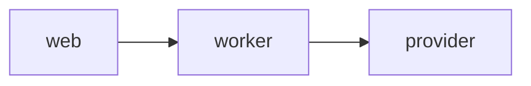

# @sendex/docs

The Sendex user guide and engineering docs, built with [Starlight](https://starlight.astro.build/) on Astro. Deployed as its own Vercel project with the root directory set to `docs` (see `vercel.json`).

## Run it

From the repository root, after `pnpm install`:

```sh
pnpm --filter @sendex/docs dev        # http://localhost:4321
pnpm --filter @sendex/docs build      # static output in docs/dist (git-ignored)
pnpm --filter @sendex/docs preview    # serve docs/dist
pnpm --filter @sendex/docs typecheck  # astro check
```

`pnpm lint` at the root covers this package too (Biome skips `.astro` files and the generated `.astro/` cache, and its Markdown formatter is off because it rewrites YAML front matter).

`@emnapi/core` and `@emnapi/runtime` are listed as devDependencies only to pin them to the same 1.x line: `astro check` loads `@astrojs/astro2tsx`, whose `@napi-rs/wasm-runtime` peer otherwise resolves `@emnapi/runtime` to a 2.0 beta while `@emnapi/core` stays on 1.x, and the two crash on load. Drop the pin once `@astrojs/check` ships a release that does not need it.

## Where things are

````
astro.config.mjs            Starlight title, sidebar, head scripts
src/content.config.ts       the docs content collection
src/content/docs/           every page, one Markdown file each
  index.md                  landing page
  using/                    how-to pages for marketers
  engineering/              architecture, queues, providers, runbooks/
  decisions/                one page per ADR (autogenerated sidebar)
src/plugins/remark-mermaid.mjs   turns ```mermaid fences into <pre class="mermaid">
public/mermaid-init.js      renders those blocks in the browser
````

Add a page by dropping a `.md` file with `title` front matter under `src/content/docs/`, then add it to the sidebar in `astro.config.mjs` (the Decisions group picks up new files on its own).

## How diagrams work

Write a fenced code block with the `mermaid` language:

````md

````

At build time `src/plugins/remark-mermaid.mjs` rewrites the fence into a `<pre class="mermaid">` element before Expressive Code sees it, so it is not syntax-highlighted as code. In the browser `public/mermaid-init.js` (added to every page through Starlight's `head` option) imports a pinned Mermaid build from jsDelivr, renders every `pre.mermaid` into inline SVG, and re-renders when the light/dark toggle changes.

Why client-side rather than `rehype-mermaid`: the build-time route needs Playwright and a headless browser on every machine and CI runner that builds the site, for a handful of diagrams. Rendering in the browser keeps the build a plain `astro build` with no native dependencies. The cost is that the diagrams need JavaScript and a network fetch of the Mermaid bundle; if that ever matters (offline docs, no-JS readers), swap the plugin for `rehype-mermaid` with `strategy: "img-svg"` and install Playwright in CI.

To bump Mermaid, change the version in `MERMAID_URL` in `public/mermaid-init.js`.

## Where ADRs live

Architecture decision records are kept as Markdown in `docs/adr/` (card D3-16), numbered `0001-…`, `0002-…`. Each one has a matching page under `src/content/docs/decisions/` so it appears in the site's **Decisions** sidebar group. When you add an ADR, copy it to `decisions/` with Starlight front matter (`title`, `description`, `sidebar.order`). Until D3-16 lands, the four decision pages are placeholders.

Per `AGENTS.md`, a feature PR updates its how-to page under `using/` or `engineering/` in the same PR, and adds an ADR when it makes an architectural choice.
