# Database ER diagram

Every table in `packages/db/src/schema` with its columns and SQL types. `PK`, `FK` and `UK` mark primary keys, foreign keys and unique columns (a `UK` on a column of a composite unique index says which columns it is unique with). Each line between two entities is a foreign key, labelled with the referencing column, drawn from the parent to the child. Tenant tables carry `organisation_id`; the ledger has no balance column (see AGENTS.md).

```mermaid
erDiagram
  ad_texts {
    boolean active
    uuid campaign_id FK
    text encoding
    uuid id PK
    uuid organisation_id FK
    integer parts
    integer position
    text text
  }
  api_tokens {
    timestamp_with_time_zone created_at
    uuid created_by FK
    uuid id PK
    timestamp_with_time_zone last_used_at
    text name
    uuid organisation_id FK
    text prefix
    timestamp_with_time_zone revoked_at
    text[] scopes
    text token_hash UK
  }
  audit_log {
    text action
    uuid actor_user_id FK
    timestamp_with_time_zone created_at
    jsonb details
    uuid id PK
    text ip
    uuid organisation_id FK
    text target_id
    text target_type
  }
  campaign_links {
    boolean active
    uuid campaign_id PK, FK
    uuid link_id PK, FK
    uuid organisation_id FK
  }
  campaign_lists {
    uuid campaign_id PK, FK
    uuid list_id PK, FK
    uuid organisation_id FK
  }
  campaign_sid_group {
    uuid campaign_id PK, FK
    uuid organisation_id FK
    uuid sid_group_id FK
  }
  campaigns {
    boolean autosender
    integer autosender_ctr_floor_percent
    integer autosender_measure_minutes
    integer autosender_scale_factor
    text autosender_stop_reason
    timestamp_with_time_zone autosender_stopped_at
    contact_reuse contact_reuse
    char(2) country
    timestamp_with_time_zone created_at
    uuid created_by FK
    uuid id PK
    text name
    uuid organisation_id FK
    timestamp_with_time_zone scheduled_at
    campaign_status status
    integer test_size
    text timezone
    timestamp_with_time_zone updated_at
  }
  clicks {
    timestamp_with_time_zone at
    uuid campaign_id FK
    char(2) country
    text device
    uuid id PK
    text ip
    uuid lap_id FK
    uuid message_id FK
    text operator
    uuid organisation_id FK
    text user_agent
  }
  contacts {
    char(2) country
    timestamp_with_time_zone created_at
    text custom1
    text custom2
    text custom3
    text custom4
    text custom5
    text e164 UK "unique with organisation_id"
    text email
    text first_name
    uuid id PK
    text last_name
    uuid organisation_id FK, UK "unique with e164"
  }
  laps {
    boolean active
    boolean autosender
    bigint budget_micro
    uuid campaign_id FK
    integer clicks
    text comment
    bigint cost_micro
    timestamp_with_time_zone created_at
    integer delivered
    integer failed
    timestamp_with_time_zone finished_at
    uuid id PK
    integer leads
    uuid list_id FK
    uuid organisation_id FK
    integer previews
    integer rank
    text refusal_reason
    integer refused
    bigint revenue_micro
    uuid route_id FK
    integer sales
    timestamp_with_time_zone scheduled_at
    integer sent
    timestamp_with_time_zone started_at
    lap_status status
    integer test_size
  }
  ledger_entries {
    bigint amount_micro
    timestamp_with_time_zone created_at
    uuid id PK
    text idempotency_key UK
    ledger_kind kind
    text note
    uuid organisation_id FK
    text reference_id
    text reference_type
  }
  links {
    boolean active
    timestamp_with_time_zone created_at
    uuid id PK
    text name
    uuid organisation_id FK
    bigint profit_micro
    text url
  }
  list_members {
    boolean bad
    text bad_reason
    uuid contact_id FK, UK "unique with list_id"
    timestamp_with_time_zone flushed_at
    uuid id PK
    uuid list_id FK, UK "unique with contact_id"
    uuid organisation_id FK
    timestamp_with_time_zone sent_at
  }
  lists {
    char(2) country
    timestamp_with_time_zone created_at
    uuid id PK
    timestamp_with_time_zone last_sent_at
    timestamp_with_time_zone last_upload_at
    text name
    integer numbers_count
    uuid organisation_id FK
  }
  memberships {
    timestamp_with_time_zone created_at
    uuid id PK
    uuid organisation_id FK, UK "unique with user_id"
    member_role role
    uuid user_id FK, UK "unique with organisation_id"
  }
  messages {
    uuid ad_text_id FK
    uuid campaign_id FK
    uuid contact_id FK
    timestamp_with_time_zone created_at
    timestamp_with_time_zone delivered_at
    text dynamic_id
    text e164
    text encoding
    text error_code
    uuid id PK
    text idempotency_key UK
    uuid lap_id FK
    uuid link_id FK
    uuid organisation_id FK
    integer parts
    text provider_message_id
    uuid route_id FK
    text sender_id
    timestamp_with_time_zone sent_at
    text short_code
    message_status status
    text text
  }
  organisation_alerts {
    timestamp_with_time_zone acknowledged_at
    uuid acknowledged_by FK
    jsonb details
    uuid id PK
    text kind UK "unique with organisation_id, period_key"
    text message
    uuid organisation_id FK, UK "unique with kind, period_key"
    text period_key UK "unique with kind, organisation_id"
    timestamp_with_time_zone raised_at
  }
  organisation_postback_keys {
    timestamp_with_time_zone created_at
    uuid organisation_id PK, FK
    timestamp_with_time_zone rotated_at
    text secret
  }
  organisation_settings {
    timestamp_with_time_zone created_at
    integer daily_message_cap
    bigint daily_spend_cap_micro
    timestamp_with_time_zone low_balance_alerted_at
    text[] low_balance_emails
    bigint low_balance_threshold_micro
    uuid organisation_id PK, FK
    timestamp_with_time_zone updated_at
  }
  organisations {
    text clerk_org_id UK
    timestamp_with_time_zone created_at
    text currency
    uuid id PK
    text name
    text slug UK
    timestamp_with_time_zone updated_at
  }
  postbacks {
    uuid campaign_id FK
    text dynamic_id
    text event_key UK
    uuid id PK
    uuid lap_id FK
    uuid message_id FK
    uuid organisation_id FK
    jsonb params
    timestamp_with_time_zone received_at
    postback_type type
    bigint value_micro
  }
  route_prices {
    char(2) country
    uuid id PK
    bigint price_micro
    uuid route_id FK
    timestamp_with_time_zone valid_from
  }
  routes {
    boolean active
    jsonb config
    char(2) country
    uuid id PK
    text name
    uuid organisation_id FK
    text provider
  }
  sender_ids {
    boolean active
    uuid id PK
    uuid organisation_id FK
    uuid sid_group_id FK, UK "unique with value"
    text value UK "unique with sid_group_id"
  }
  sid_groups {
    boolean active
    char(2) country
    uuid id PK
    text name
    uuid organisation_id FK
  }
  suppressions {
    timestamp_with_time_zone created_at
    text e164 UK "unique with organisation_id"
    uuid id PK
    uuid organisation_id FK, UK "unique with e164"
    text reason
    text source
  }
  users {
    text clerk_user_id UK
    timestamp_with_time_zone created_at
    text email
    uuid id PK
    text name
  }

  ad_texts ||--o{ messages : "ad_text_id"
  campaigns ||--o{ ad_texts : "campaign_id"
  campaigns ||--o{ campaign_links : "campaign_id"
  campaigns ||--o{ campaign_lists : "campaign_id"
  campaigns ||--o{ campaign_sid_group : "campaign_id"
  campaigns ||--o{ clicks : "campaign_id"
  campaigns ||--o{ laps : "campaign_id"
  campaigns ||--o{ messages : "campaign_id"
  campaigns ||--o{ postbacks : "campaign_id"
  contacts ||--o{ list_members : "contact_id"
  contacts ||--o{ messages : "contact_id"
  laps ||--o{ clicks : "lap_id"
  laps ||--o{ messages : "lap_id"
  laps ||--o{ postbacks : "lap_id"
  links ||--o{ campaign_links : "link_id"
  links ||--o{ messages : "link_id"
  lists ||--o{ campaign_lists : "list_id"
  lists ||--o{ laps : "list_id"
  lists ||--o{ list_members : "list_id"
  messages ||--o{ clicks : "message_id"
  messages ||--o{ postbacks : "message_id"
  organisations ||--o{ ad_texts : "organisation_id"
  organisations ||--o{ api_tokens : "organisation_id"
  organisations ||--o{ audit_log : "organisation_id"
  organisations ||--o{ campaign_links : "organisation_id"
  organisations ||--o{ campaign_lists : "organisation_id"
  organisations ||--o{ campaign_sid_group : "organisation_id"
  organisations ||--o{ campaigns : "organisation_id"
  organisations ||--o{ clicks : "organisation_id"
  organisations ||--o{ contacts : "organisation_id"
  organisations ||--o{ laps : "organisation_id"
  organisations ||--o{ ledger_entries : "organisation_id"
  organisations ||--o{ links : "organisation_id"
  organisations ||--o{ list_members : "organisation_id"
  organisations ||--o{ lists : "organisation_id"
  organisations ||--o{ memberships : "organisation_id"
  organisations ||--o{ messages : "organisation_id"
  organisations ||--o{ organisation_alerts : "organisation_id"
  organisations ||--o{ organisation_postback_keys : "organisation_id"
  organisations ||--o{ organisation_settings : "organisation_id"
  organisations ||--o{ postbacks : "organisation_id"
  organisations ||--o{ routes : "organisation_id"
  organisations ||--o{ sender_ids : "organisation_id"
  organisations ||--o{ sid_groups : "organisation_id"
  organisations ||--o{ suppressions : "organisation_id"
  routes ||--o{ laps : "route_id"
  routes ||--o{ messages : "route_id"
  routes ||--o{ route_prices : "route_id"
  sid_groups ||--o{ campaign_sid_group : "sid_group_id"
  sid_groups ||--o{ sender_ids : "sid_group_id"
  users ||--o{ api_tokens : "created_by"
  users ||--o{ audit_log : "actor_user_id"
  users ||--o{ campaigns : "created_by"
  users ||--o{ memberships : "user_id"
  users ||--o{ organisation_alerts : "acknowledged_by"
```

Generated from the Drizzle schema by `pnpm --filter @sendex/db erd` (27 tables, 55 relationships). Do not edit by hand: regenerate after every schema change. CI runs `pnpm --filter @sendex/db erd:check` and fails when this file is stale.
