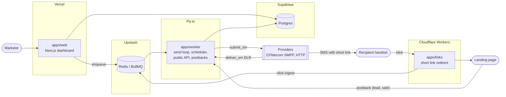

Sendex is three deployable apps and two managed data stores. The web dashboard runs on Vercel, the worker (send loop, scheduler, provider adapters, public API, postbacks) on Fly.io, and the short-link service on Cloudflare Workers. Postgres lives on Supabase and Redis on Upstash. Only the worker ever talks to a carrier.

## Request paths

- **Dashboard.** `apps/web` is a Next.js App Router app. Pages are server components reading through `packages/db` helpers scoped by organisation; mutations are server actions validated with Zod schemas from `packages/core`. The web app never calls a provider; it writes rows and enqueues jobs.
- **Worker.** `apps/worker` consumes the BullMQ queues listed in [Services and queues](/engineering/services-and-queues/), holds the SMPP binds and HTTP clients for each provider, exposes the public API (Hono with zod-openapi) and receives postbacks.
- **Links.** `apps/links` is a Hono app on Cloudflare Workers. It resolves a short code at the edge, records the click to a queue, and redirects to the campaign's destination URL with the click id appended.

## The tracking loop

1. The worker submits a message with a unique short link and debits the ledger in the same transaction.
2. The provider returns a delivery receipt; the worker's `dlr` consumer updates the message to delivered or failed and refunds non-billable failures.
3. The recipient taps the link; the edge service captures the click and redirects.
4. The landing page posts back a registration or sale carrying the click id; the worker attributes it to the message, route and campaign.
5. The results page aggregates sent, delivered, failed, clicks, leads, sales and cost per route and campaign.

## Packages

| Package              | Role                                                                                         |
| -------------------- | -------------------------------------------------------------------------------------------- |
| `packages/db`        | Drizzle schema, migrations, seed, organisation-scoped query helpers.                         |
| `packages/core`      | Pure logic: send-count maths, GSM-7/UCS-2 counting, lap planning, ledger rules, Zod schemas. |
| `packages/providers` | The `Provider` interface and the SMPP, HTTP and fake adapters.                               |
| `packages/ui`        | Shared shadcn components and chart wrappers.                                                 |

Decisions behind this shape are recorded as ADRs under [Decisions](/decisions/0001-worker-on-fly-io/).
