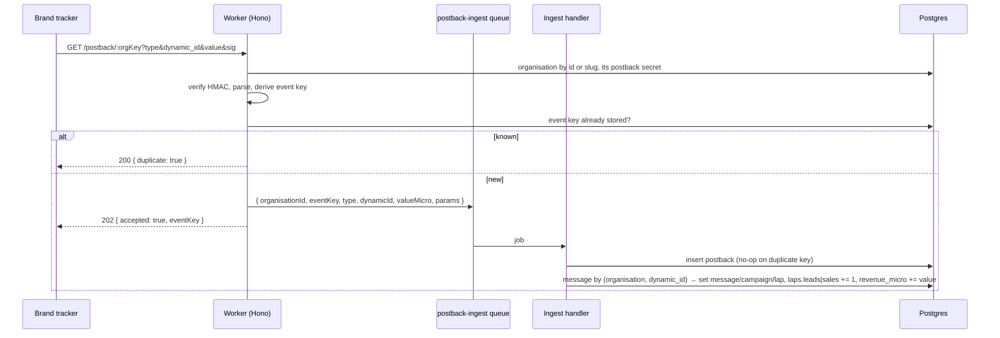

Cards D3-02 (endpoint), D3-03 (attribution) and D3-04 (log page). A brand's tracker calls the worker once per conversion; the worker verifies the call, queues it, stores it, attributes it to the message that carried the dynamic id and bumps the lap counters. The dashboard lists events and shows conversion rates per campaign, lap, sender id and ad text. The user-facing page is [Track conversions](/using/track-conversions/).



## Pieces

| Where | What |
| --- | --- |
| `packages/core/src/postbacks.ts` | `parseIncomingPostback` (Zod: `type` with aliases registration→lead, deposit/ftd→sale; `dynamic_id`; optional `value` in EUR as decimal string or number → micro-EUR; optional `event_key`; every other parameter kept), `canonicalPostbackQuery`, `signPostbackQuery`, `verifyPostbackSignature` (HMAC-SHA256, constant-time), `buildPostbackUrl`, `deriveEventKey`, `conversionRates`. |
| `packages/db/src/schema/postback-keys.ts` | `organisation_postback_keys`: one secret per organisation, generated on first read. |
| `packages/db/src/queries/postback-keys.ts` | `getOrCreatePostbackKey`, `rotatePostbackKey`, `findOrganisationByKey` (id or slug). |
| `packages/db/src/queries/postbacks.ts` | `insertPostback` (duplicate key → `inserted: false`), `attributePostback` (one transaction, idempotent), `findPostbackByEventKey`, `listPostbacks`, `conversionStats`. |
| `apps/worker/src/postbacks/routes.ts` | `createPostbackRoutes({ db, enqueue, rateLimit?, log? })`: `GET|POST /postback/:orgKey`. |
| `apps/worker/src/postbacks/ingest.ts` | `createPostbackIngestHandler(db, log?)`, `ingestPostback`, `postbackIngestPayloadSchema`. |
| `apps/web/app/(dashboard)/reports/postbacks/` | Postback Logs page (`campaign.view`), filters, CSV export route. |
| `apps/web/app/(dashboard)/settings/postbacks/` | URL and secret page (`settings.view`), rotate action (`settings.manage` + recent sign-in + audit row `postback.secret_rotate`). |
| `apps/web/components/campaigns/conversions-section.tsx` | Analytics tab: totals, per sender id, per ad text. |

## Security (ADR 0004)

- **Signed URLs.** The signature is HMAC-SHA256 over the sorted, percent-encoded query without `sig`, keyed by the organisation's secret. Verification uses `timingSafeEqual`; a missing, malformed or wrong signature is a 401 before anything is parsed, and each rejection is logged (`postback signature rejected`, with a per-organisation running count in `rejected`) so a flood is visible.
- **Replay protection.** The event key is `sha256(organisation \n type \n dynamic_id \n event_key)` truncated to 128 bits and prefixed with the type (`lead_…`, `sale_…`). It is unique in `postbacks`, so a retried call answers `duplicate` at the endpoint and, if two land at once, `insertPostback`'s `on conflict do nothing` makes the second ingest a no-op. Attribution only runs for a row whose `message_id` is still null, so counters move once.
- **Tenancy.** The organisation comes from the URL and is verified by its own secret; attribution only looks at messages of that organisation, so a dynamic id of another tenant never matches.
- **Rate limit.** `createPostbackRoutes` takes an optional `rateLimit(organisationId) → Promise<boolean>`; wire Upstash Ratelimit there in production (429 when it resolves false).
- **Secret rotation.** `rotatePostbackKey` replaces the secret in place; the old one stops working immediately. The action requires `settings.manage`, `assertRecentAuth()` and writes an audit row without the secret.

## Wiring into the worker

The worker owner mounts the routes and the handler:

```ts
// apps/worker/src/index.ts
import { createPostbackRoutes } from "./postbacks/routes.js";
app.route("/", createPostbackRoutes({ db: db(), enqueue: (job) => queues.postbackIngest.add("postback", job) }));

// apps/worker/src/handlers.ts
import { createPostbackIngestHandler } from "./postbacks/ingest.js";
postbackIngest: createPostbackIngestHandler(db()),
```

`postbackIngestJobSchema` in `jobs.ts` must gain `organisationId: nonEmpty`: the processor validates `job.data` with that schema and Zod strips unknown keys, so without it the handler throws `postbackIngest job is missing organisationId`.

## Attribution

`messages.dynamic_id` is what the send loop substitutes for `{{dynamic}}` in the tracked link; the brand echoes it back. The ingest matches `(organisation_id, dynamic_id)` to the newest message and copies `message_id`, `campaign_id`, `lap_id` onto the postback, then increments `laps.leads` or `laps.sales` and adds a sale's `value_micro` to `laps.revenue_micro`. Sales are first deposits only: a sale on a message that already has an attributed sale (a repeat deposit, sent with a distinct `event_key`) adds to `revenue_micro` but not to `laps.sales`. The message row is locked (`for update`) during attribution so two sales arriving together cannot both count as first. The read side follows the same rule: `conversionStats`, the dashboard message facts and the list analytics count at most one sale per message. Unknown dynamic ids are stored unattributed (shown as such in the log) and logged as `postback not attributed`.

`conversionStats` reads lap counters for the campaign totals and laps, and joins `postbacks → messages` for the per-sender-id and per-ad-text breakdowns. Cost per group is allocated per message as `laps.cost_micro / laps.sent`. For that the send loop should fill the new nullable `messages.ad_text_id` (and `messages.link_id`) when it inserts a message; until it does, every message lands in the "No ad text" row.

## Testing

- `packages/core/src/postbacks.test.ts`: aliases, value parsing, signatures, URLs, event keys, rates.
- `packages/db/src/queries/postback-keys.test.ts`, `postbacks.test.ts` (PGlite): key lifecycle, idempotent insert and attribution, log filters, stats.
- `apps/worker/src/postbacks/routes.test.ts` (`app.request()`): signed GET by slug and id, aliases, decimal value, bad / missing / tampered signature, 404, 400, duplicate, 503, 429, POST JSON and form bodies.
- `apps/worker/src/postbacks/ingest.test.ts` (PGlite): lead, replay, sale with value, unknown dynamic id, missing organisation id.
- `apps/web/e2e/postbacks.spec.ts` (Playwright): seeds a message and a lead directly, then checks Postback Logs (filters, search, CSV), the campaign's Analytics tab and the settings page.
