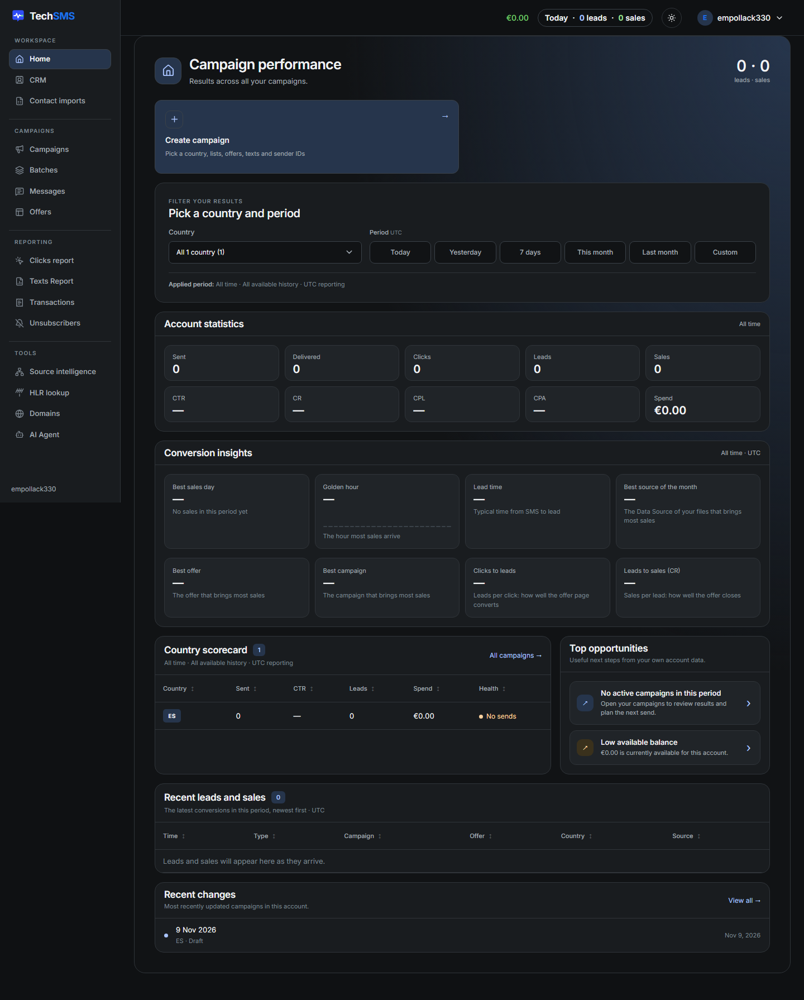
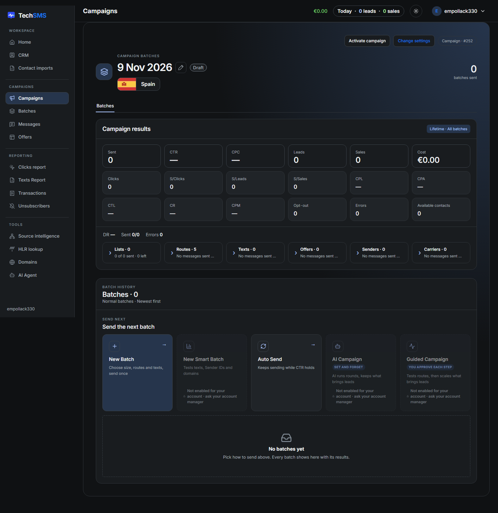

# TechSMS app walkthrough

Date: 11 Nov 2026. Source: the TechSMS web app at `https://techsms.ai/app`, signed in with the trial login TechSMS gave us after the demo (organisation `empollack330`). The account is empty: one draft campaign (#252, Spain, created 9 Nov 2026), one offer, no contacts, balance €0.00.

How it was explored: a browser script signed in, opened every page reachable from the menus, opened every menu, filter list and pop-up form it could, took a full-page screenshot of each and recorded every heading, button, field, table column and link with its position on the page (1440 × 900 screen). Nothing was saved, sent, bought, uploaded or deleted. A pop-up form was opened, recorded and closed without pressing anything inside it.

Not opened, because the button might act straight away: Duplicate campaign, New Batch, Auto Send, Remove rejected numbers, Refresh statistics, Export, Activate campaign, Change settings, the day/night switch, Enable 2FA, Top up, Submit request and the offer mode cards (Specific offers, Offers 2.0). What they do is written below from the text on their cards.

Screenshots are in `techsms-app/` next to this file; each section names its own.

## Contents

- [The overall layout](#the-overall-layout)
- [Menu and links](#menu-and-links)
- [Top bar and account menu](#top-bar-and-account-menu)
- [Home](#home)
- [CRM](#crm)
- [Contact imports](#contact-imports)
- [Campaigns](#campaigns)
- [Create a campaign](#create-a-campaign)
- [Campaign setup](#campaign-setup)
- [Campaign page](#campaign-page)
- [Batches](#batches)
- [Messages](#messages)
- [Offers](#offers)
- [Clicks report](#clicks-report)
- [Texts Report](#texts-report)
- [Transactions](#transactions)
- [Unsubscribers](#unsubscribers)
- [Source intelligence](#source-intelligence)
- [HLR lookup](#hlr-lookup)
- [Domains](#domains)
- [AI Agent (Telegram)](#ai-agent-telegram)
- [Billing](#billing)
- [Settings](#settings)
- [Plan and features](#plan-and-features)
- [Their metrics](#their-metrics)
- [Not in Sendex today](#not-in-sendex-today)

## The overall layout

- **Dark theme by default**, with a day mode switch in the top bar. Navy surfaces, white text, blue accent, green for money.
- **Left sidebar**, fixed, 216 px wide and full height:
  - the TechSMS logo at the top;
  - four groups with small uppercase labels: WORKSPACE, CAMPAIGNS, REPORTING, TOOLS;
  - each item is an icon plus a name, 36 px tall, and the current page is highlighted with a filled rounded bar;
  - the organisation name sits at the bottom.
- **Top bar**, 64 px tall across the rest of the width:
  - left: the page name, on some pages (Campaigns, Create Campaign, Security);
  - right, in order: the balance in green (links to Billing), the "Today · 0 leads · 0 sales" pill, the day/night switch, and the account button (avatar letter, organisation name, chevron).
- **Content** sits in one large rounded card that starts 240 px from the left and fills the width. Every page follows the same pattern:
  - **Page head:**
    - top left, a square icon tile, the page title (about 28 px, bold) and a one-line subtitle;
    - top right, one big number with a small label: "0 · 0 leads · sales" on Home, "0 contacts" on CRM, "0 batches sent" on a campaign.
  - **Action cards:**
    - a row of 2 to 5 large tiles, each with an icon, a bold name, a one-line description and an ↗ or → arrow;
    - the first tile is often filled blue (Create campaign);
    - a tile that is not in the plan is greyed out with "Not enabled for your account · ask your account manager".
  - **Filter panel:**
    - a box with a small uppercase label ("FILTER YOUR RESULTS") and a title ("Pick a country and period");
    - dropdowns 253 px wide in a four-column grid;
    - period chips (Today, Yesterday, 7 days, This month, Last month, Custom) and an "Applied period: …" line underneath;
    - all reporting is in UTC and the label says so.
  - **KPI grid:** boxes of 5 or 6 per row, each with a small label on top and a big number below.
  - **Tables:**
    - every column header has a sort arrow (↕, or ▼ on the sorted one);
    - a count badge sits beside the table title ("Batch results 0");
    - wide tables scroll sideways with a "Scroll for all metrics →" hint, and many have a Total row;
    - an empty table shows one plain sentence ("Leads and sales will appear here as they arrive.").
- **Pop-up forms** mostly open inside the page, as a panel with ✕ at the top right and Cancel / main action at the bottom right. Dropdowns are lists with a "Select" control per option. The custom date picker is a small dialog with From, To, Cancel and Apply, marked UTC.

## Menu and links

| Group | Item | Link | What it is |
| --- | --- | --- | --- |
| Workspace | Home | `/app/home` | Account results, insights and next steps |
| Workspace | CRM | `/app/crm` | Every contact with its performance and number check status |
| Workspace | Contact imports | `/app/files` | Uploaded files and how each file performed |
| Campaigns | Campaigns | `/app/campaigns` | Campaign list with 24 metric columns |
| Campaigns | Batches | `/app/batches` | Every batch (a send round) across campaigns |
| Campaigns | Messages | `/app/messages` | Every SMS with route, status and carrier response |
| Campaigns | Offers | `/app/offers` | Offer links per country, platforms, postback guide |
| Reporting | Clicks report | `/app/history` | Real people vs bots, per route; checks whether leads are real |
| Reporting | Texts Report | `/app/text-report` | Performance of every SMS text |
| Reporting | Transactions | `/app/transactions` | Balance movements |
| Reporting | Unsubscribers | `/app/unsubscribers` | Opt-out log |
| Tools | Source intelligence | `/app/crm/intelligence` | Score a supplier's number list against your CRM |
| Tools | HLR lookup | `/app/hlr` | Number checks, bulk or by contact |
| Tools | Domains | `/app/settings/domains` | Link domains, buying and automatic rotation |
| Tools | AI Agent | `/app/settings/chat` | Telegram bot that runs campaigns by chat |

Pages not in the menu:

| Page | Link | Reached from |
| --- | --- | --- |
| Billing | `/app/billing` | Balance in the top bar |
| Create campaign | `/app/campaigns/new` | Create campaign tiles |
| Campaign setup | `/app/campaigns/{number}/setup` | A draft campaign |
| Campaign page | `/app/campaigns/{number}/batches` | Campaign overview |
| Buy domains | `/app/settings/domains/buy` | Domains › Buy domains |
| Settings | `/app/settings` with `#profile`, `#alerts`, `#billing`, `#plan`, `#blacklist`, `#postback` | Account menu › Settings |
| Partner reporting | `/app/settings/partner-reporting` | Settings menu |
| My routes | `/app/settings/routes` | Settings menu |
| Security | `/app/settings/security` | Settings › Two-step login › Manage |
| Contacts export | `/api/internal/contacts/export.csv` | CRM › Export |
| Transactions export | `/api/internal/export/transactions.csv` | Billing › Export CSV |

## Top bar and account menu

Screenshots: `p2-10-header-account-menu.png`, `p2-11-header-today-leads.png`.

- **Balance**: green amount, links to Billing.
- **Today pill**: "Today · 0 leads · 0 sales". It opens a small panel under it:
  - TODAY, the lead and sale counts, and "No leads or sales yet today. New ones show up here as they arrive.";
  - a "Desktop alerts blocked" notice. Desktop notifications are turned on from the bottom of this feed.
- **Day mode switch**: a sun icon, 36 px round button.
- **Account menu** (avatar, name, chevron) opens a 224 px menu under the top right corner:
  - Organisation;
  - Settings, AI Agent, Partner reporting, Security & 2FA, Blacklist & opt-outs, Sub-accounts;
  - Sign out.

## Home

Link: `/app/home`. Screenshots: `01-home.png`, `p2-12-home-country-picker.png`, `p2-13-home-custom-period.png`.

Top to bottom:

- **Head**:
  - "Campaign performance", "Results across all your campaigns.";
  - top right, "0 · 0" with "leads · sales".
- **Create campaign** tile (blue, half width): "Pick a country, lists, offers, texts and sender IDs", links to `/app/campaigns/new`.
- **Filter panel** "Pick a country and period":
  - Country dropdown on the left. Its list shows each country with a count and "0 active · 1 draft".
  - Period chips on the right, labelled UTC.
  - Custom opens a From / To dialog.
  - Underneath: "Applied period: All time · All available history · UTC reporting".
- **Account statistics** (All time), 10 boxes in two rows: Sent, Delivered, Clicks, Leads, Sales / CTR, CR, CPL, CPA, Spend.
- **Conversion insights**, 8 boxes in two rows of four:
  - Best sales day;
  - Golden hour ("The hour most sales arrive", with a small chart line);
  - Lead time ("Typical time from SMS to lead");
  - Best source of the month ("The Data Source of your files that brings most sales");
  - Best offer;
  - Best campaign;
  - Clicks to leads ("how well the offer page converts");
  - Leads to sales (CR) ("how well the offer closes").
- **Country scorecard** (left two-thirds), a table:
  - columns: Country, Sent, CTR, Leads, Spend, Health;
  - Health shows a coloured dot with a word, for example "No sends";
  - an "All campaigns →" link sits top right.
- **Top opportunities** (right third): "Useful next steps from your own account data", shown as clickable rows with an arrow. Seen:
  - "No active campaigns in this period" (links to Campaigns);
  - "Low available balance: €0.00 is currently available" (links to Billing).
- **Recent leads and sales**, a table: Time, Type, Campaign, Offer, Country, Source.
- **Recent changes**: the most recently updated campaigns, each with date, country and status. "View all →" links to Campaigns.

## CRM

Link: `/app/crm`. Screenshots: `04-crm.png`, `p2-14` to `p2-21`.

- **Head**:
  - "CRM Contacts", "Performance and source history of every number";
  - top right, "0 contacts".
- **CRM results**, "Exact filtered statistics", a KPI grid:
  - Contacts, Sent, CTR, CPC, Leads, Sales, Clicks, CTL, CR, CPL, CPA;
  - HLR active, HLR pending, Bad HLR, HLR failed, Not checked, Cost.
  - Notes under the grid: "Every statistic recalculates from the same active CRM filters."
- **Find the numbers you want**, a filter panel:
  - Search ("Phone, name or email"), Country, Data source, Period, Files, Carrier, Brand, Platform.
  - Period options: All time, Today, Yesterday, This week, This month, Last month, Custom… Each option shows its real dates.
- **Activity filters**, five cards in a row: Sent, Clicks, Leads, Sales and Rejected.
  - Each card shows a count, a "Show these numbers →" link (for example "Show the numbers with at least 1 click") and an "Any" dropdown for the threshold.
- **Number check status**, a row of 8 chips, each with a count and a tooltip:
  - All statuses;
  - Active ("phone is on");
  - Inactive ("phone off, busy or inbox full");
  - Unknown ("carrier only, no HLR for this network");
  - Bad HLR ("number is dead or invalid");
  - Failed ("lookup got no answer");
  - Pending ("lookup running");
  - Not checked ("never looked up").
- **Action tiles**, five in a row:
  - Create campaign;
  - Add to existing campaign. It opens a panel: pick a campaign, "0 contacts match the current filters", Close / Add contacts. The campaign's country is applied and overlapping contacts count once.
  - Import contacts. It opens the Import file panel: "CSV / Excel · up to 100 MB · 500,000 data rows", plus "Resume an earlier import".
  - Run HLR ("Check which numbers are active"), greyed out with no contacts.
  - Remove rejected numbers ("Remove numbers that were rejected too often").
- **Contact performance**, a table:
  - toolbar: Export (CSV), Show full numbers (numbers are masked by default) and Refresh;
  - columns: Phone Number, Country, Carrier, Data Source, Added, HLR Status, Sent, Rejected, Clicks, Leads, Sales, CTR, CTL, CR, CPC;
  - a Total row, and a formula line under the table: "CTR = clicks / sent · CTL = leads / clicks · CR = sales / leads".

## Contact imports

Link: `/app/files`. Screenshots: `05-files.png`, `p2-22-files-import-contacts.png`.

- **Head**:
  - "Contact imports", "Imported files, validation results and lifetime performance";
  - top right, "0 numbers in files".
- **Import results**, a KPI grid: Files, Numbers in files, Invalid numbers, Leads, Sales.
- **Tiles**:
  - Import contacts (the same Import file panel as in CRM);
  - Analyze a list ("Score a supplier list before you send to it", links to Source intelligence);
  - Create campaign.
- **Import history**, a table. "Results refresh automatically."
  - Columns: Added on, File name, Data Source, Actions, Numbers in file, Invalid numbers, Status, List check, HLR, Sent, Delivered, Clicks, CTR, Leads, Sales, Cost, CPL, CPA, Rejected.
  - Each file is tagged with a **Data Source** (the supplier), which feeds the CRM filter and "Best source of the month" on Home.

## Campaigns

Link: `/app/campaigns`. Screenshot: `06-campaigns.png`.

- **Head**: "Campaigns", with the Create campaign tile under it.
- **Filters**:
  - a country dropdown ("All 1 country (1)");
  - period chips with Custom;
  - a round Refresh button at the far right.
- **Campaign performance**, a table with **Export report** at its top right:
  - The ID # and Campaign cells show the country flag and code, the name, and a status badge (Draft).
  - Three small icon buttons sit in the row: New quick batch, Auto Send and Duplicate campaign. The first two are greyed out on a draft.
  - The campaign name links to its page.
  - The 24 columns are ID #, Campaign, Progress, Sent, Clicks, Leads, Sales, CTR, CTL, CPC, CPL, CPA, CR, Cost, CPM, Delivered, DR, Failed, Rejected, Opt-out, S/Clicks, S/Leads, S/Sales and Created, all sortable. The table is about 2,000 px wide and scrolls sideways.

## Create a campaign

Link: `/app/campaigns/new`. Screenshots: `18-campaigns-new.png`, `p2-39-new-campaign-country-list.png`.

- **A five-step wizard** across the top: 1 Details, 2 Lists, 3 Offers, 4 Texts, 5 Sender IDs. A "Campaigns" breadcrumb link sits above it.
- **Step 01, Campaign details**:
  - **Campaign country**: a full-width dropdown that defaulted to Germany, listing every country with its flag and code. Under it: "Only numbers from Germany will be used in this campaign, even from a mixed-country list."
  - **Campaign name**.
  - **Top 10 countries**: quick-pick buttons with flags for Spain, United Kingdom, Australia, Italy, Poland, Sweden, Germany, Austria, Switzerland and United States.
- **Bottom**: "Creates a draft. No messages are sent." and a **Continue to Lists** button at the bottom right.

## Campaign setup

Link: `/app/campaigns/{number}/setup`, for example `/app/campaigns/252/setup`. Screenshots: `19-campaigns-252-setup*.png`, `p2-40` to `p2-46`.

- **Head**:
  - "Draft setup · #252" above the title;
  - "CAMPAIGN SETUP", the name with a pencil (Rename campaign), and a country chip (flag, ES, Spain).
- **Five tabs**, each with a count: Lists 0, Offers 0, Texts 0, Sender IDs 0, Send.
- **Footer**: every tab has "← previous" at the bottom left and "Continue to … →" at the bottom right.

**Lists tab** ("BUILD YOUR AUDIENCE · Add contacts to your campaign"):
- Big counter: "0 unique ES contacts".
- Three tiles:
  - **Add existing list** opens "CAMPAIGN AUDIENCE":
    - "Only ES contacts can be added";
    - a list picker with tabs All / Recent / Source, a Sources filter and search;
    - columns List, Contacts, Added on;
    - "0 unique Spain contacts selected", then Cancel / Add to campaign.
  - **Import from CRM** opens the whole CRM filter panel inside the campaign:
    - an HLR status filter, "Name in this campaign" and "0 Spain contacts match";
    - "Each number counts once in the campaign", then Cancel / Add to campaign.
  - **Import new file**: CSV or Excel.
- "Campaign lists · 0 included" table. "Only Spain numbers are included. Setup does not send messages."
- A "Campaign overview" link at the bottom left goes to the campaign page.

**Offers tab** ("Campaign offers"), two mode cards:
- **Specific offers** ("Fixed offers · fixed destinations"): "Sent links keep their selected offer and do not switch to another offer when it is disabled."
- **Offers 2.0** ("Active offers · smart redirects"): "Uses active offers for this country. If an offer is disabled, later clicks on existing SMS links go to other eligible active offers for the same country."

**Texts tab**:
- Four tiles:
  - Import .txt ("One SMS per line, up to 50 texts");
  - Add from history ("Texts that worked in your past campaigns"). It opens a picker filtered to the campaign country, sorted by Best CTR, with Sent and CPA/S per text.
  - Add text ("Write a new message"). It opens an editor:
    - a live counter, "0 / 160 GSM-7 units · with preview values" and "0 / 1 SMS";
    - Insert shortcode chips: `{{url}}`, `{{http_url}}`, `{{https_url}}`, `{{first_name}}`, `{{last_name}}`, `{{opt_out_link}}`, `{{custom_field_1..3}}`, `{{email}}`;
    - the rule: "One SMS only. Final messages exceeding the limit after links and recipient values are inserted are blocked, never truncated."
  - **Generate texts** ("AI writes texts for your selected offers"), greyed out until an offer is chosen.
- **Text performance** table: ID, Text preview, Offer, Score, Sent, Clicks, Leads, Sales, CTR, CTL, CR, CPC, CPL, CPA, Actions, Active (an on/off switch per text).

**Sender IDs tab**:
- Four tiles:
  - Import .txt ("One sender ID per line, up to 20");
  - Add from history (same style as for texts);
  - Add sender ID: "Use 1–11 letters or digits, without spaces or symbols", with a "0 / 11 characters" counter;
  - **Generate sender IDs** (AI), greyed out.
- **Sender ID performance** table: ID, Sender ID, Offer, Sent, Clicks, Leads, Sales, CTR, CTL, CR, CPC, CPL, CPA, Active.
- **Checklist** at the bottom, as links: "Add a list →", "Choose an offer →", "Add an active text →", "Add an active sender ID →". **Continue to Send** stays greyed out until all four are done.

**Send tab** ("Choose how to send"), five cards in a row:

| Card | Label | What it says | This account |
| --- | --- | --- | --- |
| New Batch | MANUAL | You pick the size, routes and texts, then send once | Available |
| New Smart Batch | MANUAL | One batch that tests texts, Sender IDs and domains against each other | Not in plan |
| Auto Send | | Sends batch after batch on your budget and stops when CTR drops | Available |
| AI Campaign | SET AND FORGET | AI runs rounds and keeps what brings leads | Not in plan |
| Guided Campaign | YOU APPROVE EACH STEP | We test the routes, then suggest each next step for you to approve | Not in plan |

## Campaign page

Link: `/app/campaigns/{number}/batches`. Screenshot: `p2-42-builder-lists-campaign-overview.png`.

- **Top right buttons**: Activate campaign, Change settings, and a "Campaign · #252" chip.
- **Head**:
  - "CAMPAIGN BATCHES", the name with a pencil, a status badge (Draft) and a large flag chip (Spain);
  - top right, "0 batches sent".
- **One tab**: Batches.
- **Campaign results** ("Lifetime · All batches" chip), 18 boxes in three rows:
  - Sent, CTR, CPC, Leads, Sales, Cost;
  - Clicks, S/Clicks, S/Leads, S/Sales, CPL, CPA;
  - CTL, CR, CPM, Opt-out, Errors, Available contacts.
- **Summary strip**: "DR —", "Sent 0/0" and "Errors 0", followed by six expandable chips, each with a short summary:
  - Lists · 0 ("0 of 0 sent · 0 left");
  - Routes · 5;
  - Texts · 0;
  - Offers · 0;
  - Senders · 0;
  - Carriers · 0.
- **Batch history**: "Batches · 0, Normal batches · Newest first".
- **Send the next batch**: the same five cards as the Send tab.
- An empty state ("No batches yet. Pick how to send above. Every batch shows here with its results.").

## Batches

Link: `/app/batches`. Screenshots: `07-batches.png`, `p2-23-batches-statuses.png`.

- **Filters**:
  - All countries, All campaigns, All statuses;
  - period chips in a 3 × 2 grid on the right;
  - Apply filters and Reset filters buttons.
- **Statuses**: Draft, Scheduled, Planning, Sending, Finalizing, Completed, Aborting, Aborted, Error.
- **Batch results** table, with **Refresh statistics** at the top right:
  - columns: Batch, Campaign, Progress, Budget, Countries, Status, Last activity, Sent, Delivered, DR, Clicks, CTR, Leads, CTL, Sales, CR, Cost, CPC, CPL, CPA, CPM, Failed, Rejected, Opt-out, S/Clicks, S/Leads, S/Sales.

## Messages

Link: `/app/messages`. Screenshots: `08-messages.png`, `p2-24-messages-statuses.png`.

- **Filters**: All campaigns, All statuses, All numbers, and a "Search a number" box.
- **Statuses**: Queued, Sending, Sent, Delivered, Rejected, Not delivered, Unconfirmed, Skipped.
- **Message log**, with Show full numbers and Refresh:
  - columns: Timestamp, Campaign, Batch, Message, Route, Phone, Number rejected, Status, Provider response, Parts.

## Offers

Link: `/app/offers`. Screenshots: `09-offers.png`, `p2-25` to `p2-30`.

- **Three tiles**:
  - **Add offer** ("One offer per country with the same link") opens a form:
    - Offer name, platform (default "No platform") and Offer notes;
    - **Countries**, multi-select. "Add codes" lets you paste a list, and "GCC" adds BH, KW, OM, QA, SA and AE. One offer is created per country with the same URL.
    - **Current URL**, with **Offer shortcodes** to click into it: List ID, Campaign ID, Text ID, Phone, First name, Last name, Route name, Tracking ID, Custom field 1–3, Email.
  - **Manage platforms** ("Affiliate networks and their click ID"):
    - Add platform asks for a platform name and its tracking parameter (for example clickid, afp or sub1). When an offer URL has no `{{tracking_id}}`, clicks add it automatically.
    - Active / Archived tabs and a table: Tracking parameter, Used by offers, Status, Actions (Edit, Archive). The trial has one platform, "scaleo".
  - **Postback setup**: the same guide as Settings › Postback (below), plus **Send a test lead**:
    - pick an offer and create a test link, then sign up with made-up details;
    - the lead shows as a Test lead and never counts in stats;
    - the link stays open 24 hours.
- **Filters**:
  - Name, Current URL, All platforms, All countries;
  - period chips;
  - All statuses (Active / Inactive) and a Quick search ("Offer name or ID");
  - Clear filters.
- **Offer performance** table:
  - a rows-per-page selector (25) and page arrows;
  - each offer row expands (› PM) into one row per country, with a per-country on/off switch ("Disable PM (DE)");
  - every column header has a tooltip. Columns: ID, Added, Offer, Geo, Sent, Clicks, Leads, Sales, CPL, CPA, Platform, Notes, Delivered, DR, CTR, CTL, CR, Cost, CPC, CPM, Rejected, S/Clicks, S/Leads, S/Sales, Actions, Active.

## Clicks report

Link: `/app/history`. Screenshots: `10-history.png`, `p2-31`, `p2-32`.

"Who opened your links, which routes bring real people, and whether your leads are real. Today is shown by default; choose up to 31 complete UTC dates."

- **Filters**:
  - period;
  - Outcome: Redirected, Country rule excluded, Excluded: automated, Excluded: unverified, Excluded from CTR, Historical estimate, Expired, Blocked, No target;
  - Classification: Qualified navigation, Likely browser visit, Automated, Unverified, Historical / unclassified, Historical estimate;
  - Campaign, and Batch ("Choose a campaign first");
  - **Show clicks report** button.
- **Who opened your links**, a summary of opens:
  - **Real people**, counted as clicks;
  - **Phone checks**, the phone's safety check, which "proves the SMS arrived";
  - **Scanners and bots**, not counted;
  - **Unclear**, "no proof of a person", not counted;
  - **Real leads**: "X of Y, a person tapped before the lead".
- **Bots by route**: Route, Sent, Delivered, DR, Phone seen (share of delivered SMS a phone confirmed receiving), Bot opens, Real people, CTR, Leads, Real leads, Check.
- **Leads check**: "A lead is real when a person tapped the link first and signed up at a normal pace."
  - Columns: Lead time (UTC), Campaign · Batch, Route, Person tapped first, Tap to lead, Leads from same address, Check.
- **All click events**: every open with Time (UTC), IP, Country, Classification, Outcome, Campaign, Batch, Event. The table is collapsible.

## Texts Report

Link: `/app/text-report`. Screenshot: `11-text-report.png`.

- **Filters**: Text search ("Search text or ID"), All campaigns, All countries, period.
- **Text performance**, with Export CSV:
  - columns: ID, Text, Campaign, Status, Country, Sent, Delivered, DR, Clicks, CTR, Leads, CTL, Sales, CR, Cost, CPC, CPL, CPA, CPM, Failed, Rejected, S/Clicks, S/Leads, S/Sales.

## Transactions

Link: `/app/transactions`. Screenshots: `12-transactions.png`, `p2-33`, `p2-34`.

- **Balance summary** box.
- **Filters**:
  - a search box ("Description, campaign, batch, list, or reference");
  - type: All transactions, SMS, HLR, Domains, Top-ups & payments, Adjustments;
  - direction: Credits & debits, Debits only, Credits only;
  - period;
  - Clear filters.
- **Account activity**, with Export CSV:
  - columns: Date, Activity, Reference, Debit, Credit, Net, Balance after;
  - Previous / Next paging.

## Unsubscribers

Link: `/app/unsubscribers`. Screenshot: `p2-01-page-app-unsubscribers.png`.

- "Batch and route are recorded for new link unsubscribes. Older and manually added records may have no attribution."
- **Unsubscribe log**: Phone, Country, Campaign, Batch, Route, Unsubscribed at.

## Source intelligence

Link: `/app/crm/intelligence`. Screenshots: `13-crm-intelligence.png`, `p2-35-intelligence-paste.png`.

"Import a list and see how much of it already sent, clicked, led or sold in your CRM."

- **Check a new list** (up to 500,000 numbers): "Drop the supplier's file. Every number is matched against your CRM and the list gets a score."
  - Upload area: CSV or TXT, up to 8 MiB.
  - **Paste numbers instead**: a text box for numbers or CSV with the headers phone, first_name, second_name, email, company, custom_1 to custom_3.
  - **Check list** button.
- **Checked lists**: click a list to open its score, with Newest / Older paging.
- **Funnel by sends** ("Your whole CRM, updated hourly"):
  - how many times a number was sent before it clicked, led or sold, in buckets 1, 2, 3, 4, 5, 6–10, 11–20, 21 or more;
  - columns: Numbers, CTR, Leads, Lead rate, Sales, Sale rate;
  - two summary cards: "Best send" and "Sent 21 or more times".

## HLR lookup

Link: `/app/hlr`. Screenshots: `14-hlr.png`, `p2-36` to `p2-38`.

- **Head**: "Check mobile networks and number availability before you send", with a "Ready for lookups" status.
- **Three tiles**:
  - **Bulk lookup**: up to 300,000 numbers. "One approval. No SMS is sent."
    - Pick "Upload a list" or "Imported list › Choose a completed list", then Run HLR.
    - Saved results are reused for free, and you can leave the page once it starts.
  - **Lookup history**: List, Numbers, Active, Inactive, Unknown, Not checked, Failed, Ported, Cost, Refunded, Status, Actions. Click a row for the breakdown.
  - **Individual contacts**, a three-step flow: Choose contacts › Review price › View results.
    - Search, a country filter, "Select this page" and a table: Phone number, Country, Last known carrier.
    - A summary card lists what is checked: current mobile network, number portability and availability.
    - "Refresh saved results" forces a new paid lookup.
    - "Reviewing a price is free. Nothing is charged until you confirm."

## Domains

Links: `/app/settings/domains` and `/app/settings/domains/buy`. Screenshots: `15-settings-domains.png`, `p2-02-page-app-settings-domains-buy.png`.

- **My domains**: "Domains assigned to your account and domains you bought. Switch off any you don't want in your campaigns." A Buy domains button sits at the top right.
- **Auto domains** ("AUTOMATIC · EVERY DAY"), an on/off switch with three settings:
  - New domains per day (0–10, for each day you send);
  - Switch off domains after (3–90 days; switched-off domains are kept);
  - Max price per domain (€; pricier domains are skipped);
  - "Every day you send, we buy and set up new domains for you from your balance. Each purchase shows in Transactions."
- **Buy domains**, a three-step flow: 1 Choose domains, 2 Check prices, 3 Buy & set up.
  - Two modes: "By extension & quantity" or "Enter domain names".
  - Pick the extensions (.com plus "Add extension") and the quantity, up to 10 per search.
  - **Name styles**, split equally across the ones picked:
    - Readable ("lumora · venixo");
    - Word pairs ("fastpick · goldnest");
    - Random letters ("qxwfeta · bvhrakm"), with a length of 5–10.
  - Taken names are replaced automatically.
  - "Find available domains" runs the search. "Your orders" lists purchases, and DNS and HTTPS are set up automatically.

## AI Agent (Telegram)

Link: `/app/settings/chat`, with a `#commands` tab. Screenshots: `16-settings-chat*.png`, `p3-ai-agent-commands-expanded.png`.

"Your campaigns, one conversation away. Get answers and take action in Telegram."

**Connection & access tab** (two columns: setup on the left, a sales panel on the right):
- **Your bot**:
  - connect your own Telegram bot: open @BotFather, create a bot, paste its token, then Verify & connect bot;
  - the token is encrypted and never shown again.
- **Your private connection**: link your own Telegram account once the bot is connected.
- **People with bot access**:
  - invite people by name ("Create invite"); they need no TechSMS account and each gets a private chat;
  - they can view campaigns, create campaign and batch drafts, and confirm retries;
  - new sends need their explicit confirmation of the exact batch and spending limit;
  - access lapses after 90 days unused, and any admin can revoke it.
- **Right panel**:
  - "From questions to action", with an example chat ("Clone my summer sale campaign" › "Created Summer sale (copy) as a draft…");
  - three headings: Campaign performance, Build & manage campaigns, Updates when you need them;
  - "You're in control".

**Commands tab**, "Your Telegram command library":
- Search, a group menu on the left with counts, and copy buttons.
- A 5-step strip: Audience › Active offer › Texts & senders › Routes & amount › Confirm send.
- "Copy only. Nothing runs from this page." 50 commands in all:

| Group | Commands (example to type) |
| --- | --- |
| Campaigns & audiences (8) | Create a campaign `/campaign new` · Use country clickers `GB clickers` · Use country leads `Spain leads` · Use an existing list `list: Spain Leads` · Find a campaign `Show my campaigns` · Clone a campaign `/campaign clone name="…"` · Continue setup `/campaign builder` · Create from a CRM filter `/campaign create name="ES Leads" country=ES audience=leads` |
| Offers, texts & senders (9) | Browse active offers `offers` · Offers for a country `offers GB` · Find an offer `offers Crusado` · More offers `next` · Generate 5 texts + 5 Sender IDs `generate assets — I confirm I am authorized to use [brand]` · Generate more texts `/campaign texts count=5` · Save all suggestions `save all` · Save selected `save A C` · Check generation `check progress` |
| Routes & batches (13) | Create a batch `/campaign batch` · All routes `all routes` · Specific routes `1, 3` · Previous routes `same routes` · More routes `next routes` · Total SMS `total SMS 300` · SMS per route `100 SMS per route` · Finish list `Finish list` · Budget `Send €30 budget` · Budget per route `€10 per route` · Change routes · Change amount · Approve draft `Create draft [review code]` |
| Sending & control (7) | Review draft `send` · Review a batch `/campaign send batch=3` · Confirm send `Confirm send [review code]` (expires after 5 minutes) · Status `check status` · Cancel pending step `Cancel` · Review failed batch `Retry the failed batch` · Approve / cancel retry `confirm [review code]` |
| Reports & account (4) | Performance `Show performance for …` · Help `/help` · Alerts `/techsms alerts` · Disconnect `/techsms disconnect` |
| Advanced · web review (9) | `/techsms create`, `edit`, `plan`, `prepare`, `test`, `wave`, `abort`, `stop`, `report` — each opens a review in the web app instead of acting in chat |

Still web-only, per the page: uploading a contact file, adding a catalogue offer and editing existing Sender IDs.

## Billing

Link: `/app/billing`. Screenshot: `17-billing.png`.

- **Header**:
  - "Prepaid credit in EUR. Card payments carry no fee; PayPal adds its processing fee, shown before you pay.";
  - Export CSV and **Top up** at the top right. Top up is greyed out: "Online payments are unavailable right now".
- **Balance**: Available, **Reserved for sending**, Balance.
- **Request a manual top-up**: Amount (EUR) and Customer notes, then Submit request.
- **Payments**: Date, Provider, Status, Paid, Fee, Credited, Refunded.
- **Transactions**: Date, Type, Description, Amount, with a "View all transactions" link.

## Settings

Link: `/app/settings`. Screenshots: `02-settings.png`, `p2-05` to `p2-09`, `20`, `21`, `22`.

- **Layout**: a second menu inside the content card, 218 px wide on the left, under the title "Settings". The section opens on the right.
- **Menu groups**:
  - ACCOUNT: My profile, Alerts & sounds, Billing, Plan & features, Blacklist & opt-outs;
  - TRACKING: Postback, Partner reporting;
  - INTEGRATIONS: My routes.

Sections:

- **My profile** (`#profile`):
  - Name (Save name);
  - "Email and two-step login" with a Two-step login row ("Off · Manage ↗", links to Security);
  - Change password (current and new).
- **Alerts & sounds** (`#alerts`):
  - **Phone alerts** on iPhone or iPad: add TechSMS to the Home Screen from Safari, then turn on alerts. There are 5 numbered steps, plus help for blocked notifications and missing sound.
  - **Alerts to send**, each with a switch:
    - New lead (campaign, offer, country);
    - New sale (with the sale value);
    - Batch finished (sent, delivered, clicks, leads);
    - Batch failed or stuck ("no progress for 15 minutes").
  - **This browser**: "Sound on a new lead" and "Cash register sound on a new sale". Desktop notifications are turned on from the Today feed.
- **Billing** (`#billing`):
  - the balance, with links to Add funds, Payments and transactions, and **Referral credits** ("Credits from accounts you referred");
  - "Prices, balance adjustments, refunds and closing the account are handled by TechSMS."
- **Plan & features** (`#plan`): see below.
- **Blacklist & opt-outs** (`#blacklist`): "Numbers you never want to text", with links to Blacklist and opt-outs ("Add and remove numbers") and to Unsubscribers ("People who replied STOP or used an unsubscribe link").
- **Postback** (`#postback`), a three-step guide:
  - **Step 1**: put `{{tracking_id}}` in the offer URL, in the network's sub ID parameter, for example `https://offer.com/?sub1={{tracking_id}}`. It can also be set once per platform.
  - **Step 2**: copy three server-to-server postback URLs into the network:
    - lead: `https://techsms.net/track/interaction?trackingid={sub1}&type=lead`;
    - FTD: `…&type=ftd`;
    - sale (qualified depositor): `…&type=sale`;
    - parameters: `trackingid` (required); `type` (required: lead or signup for a lead; ftd, sale or buyer for a sale; FTD and Sale both count as Sales); `value` (optional payout in EUR, added as `&value={payout}`).
  - **Step 3**: check it works. A real lead shows in the Today feed and the campaign. The same lead sent twice counts once.
- **Partner reporting** (`/app/settings/partner-reporting`): a "Partner bot", connected with a BotFather token (Verify & connect). The page shows nothing more until it is connected.
- **My routes** (`/app/settings/routes`): "My routes isn't enabled for your account."
- **Security** (`/app/settings/security`): Two-factor authentication, with an Enable 2FA button.

## Plan and features

From Settings › Plan & features: "TechSMS turns features on and off; contact your account manager to add one." This account has 14 of 22.

| Included | Not in plan |
| --- | --- |
| Campaigns, CRM, HLR lookup, Export, Texts Report, Offers, Manual sending, Auto Send, Schedules and presets, AI Agent, Labels, Click IPs, Carrier stats, Domains | Smart offers, New Smart Batch, AI Campaign, Guided Campaign, My routes, API access, SMPP gateway, Sub-accounts |

## Their metrics

Formulas the app states (CRM footer and column tooltips):
- CTR = clicks ÷ sent
- CTL = leads ÷ clicks
- CR = sales ÷ leads
- DR = delivered ÷ sent
- CPA = cost per sale
- CPM = cost per message

Also used, without a formula in the app:
- CPC = cost per click
- CPL = cost per lead
- S/Clicks, S/Leads, S/Sales: the app doesn't say what S means. The tooltip only says "A dash means attribution was not recorded, not zero results."

## Not in Sendex today

Compared with Sendex as it is on main today:

- **Telegram AI Agent** to build, review and confirm sends by chat, with invited team members, review codes and a 5-minute expiry on send approval.
- **Click quality**: real people vs phone checks vs bots, and per-route "Phone seen", which proves a delivery without a receipt. Each lead is checked as real (tapped first, normal pace, same address).
- **Source intelligence**: score a supplier's list against past results before buying or sending, and a funnel by number of sends.
- **Domains**: buy link domains in-app, with DNS and HTTPS done for you, and buy and retire domains automatically every day.
- **Offers 2.0**: smart redirect to another active offer when one is switched off, plus GCC country shortcuts and one offer per country from one form.
- **Postback test lead**: a 24-hour test link that never counts in stats, with separate lead, FTD and sale postbacks.
- **AI text and sender ID generation** (Sendex's AI only writes segment rules), plus reusing texts and sender IDs from earlier campaigns ranked by CTR.
- **Phone push alerts and sounds** for new leads and sales, and a Today feed in the top bar.
- **Home insights**: golden hour, lead time, best source, best offer, best campaign and top opportunities.
- **CRM activity filters** ("numbers with at least 1 click / lead / sale") and **Remove rejected numbers**.
- **Reserved for sending** shown apart from the available balance.
- **Plan switches** per account and **Partner reporting** by bot.
